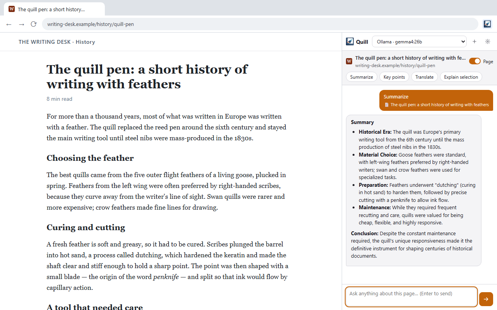
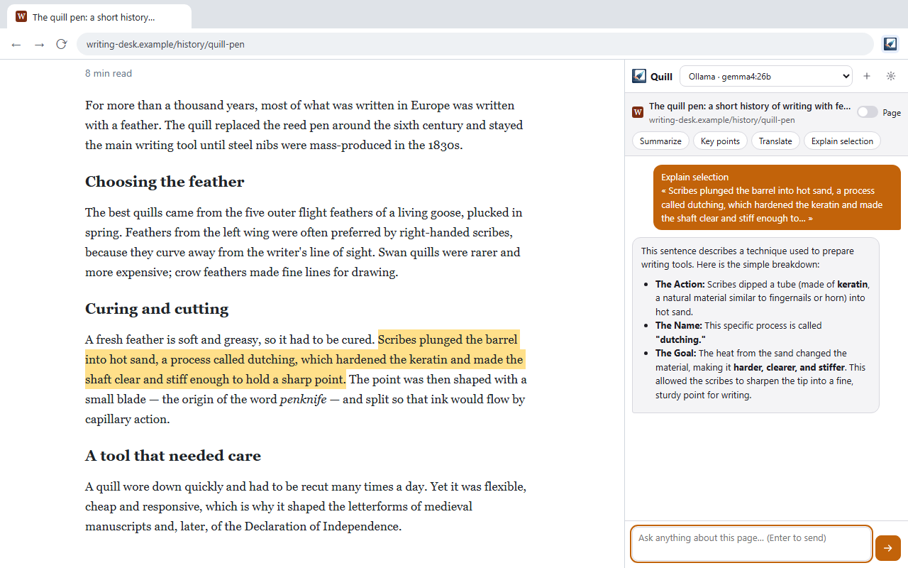
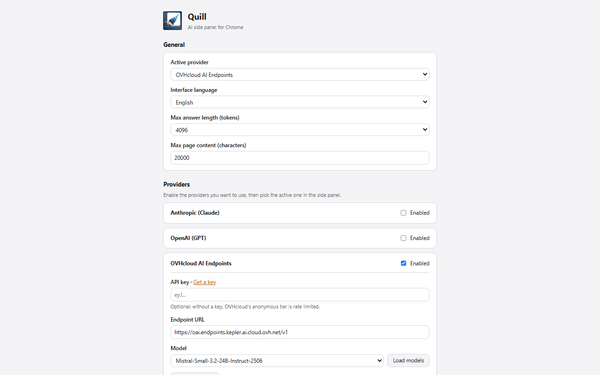

# ✒️ Quill for Chrome — v0.1

The Quill chat in Chrome's **right-hand side panel** (and other Chromium browsers: Edge, Brave, Opera, Vivaldi), with the same providers as [Quill for Thunderbird](https://github.com/mikecastrodemaria/Quill) and the ability to **talk with the current page**.

Full specification: [SPECIFICATION.md](SPECIFICATION.md). Firefox version: [Quill-Firefox](https://github.com/mikecastrodemaria/Quill-Firefox).



| Explain a selection | Settings |
|---|---|
|  |  |

## v0.1 features

- Side panel opened from the Quill icon or `Alt+Q`
- Multi-turn chat, Markdown rendering, Copy button, conversation kept for the browser session
- Providers: **Anthropic (Claude)**, **OpenAI**, **OVHcloud AI Endpoints**, **Ollama** (local), switchable from the panel header
- "Current page" card (favicon, title, URL) following the active tab
- **Page** toggle: attaches the page title, URL and text to your message (once per page)
- Quick actions: Summarize, Key points, Translate, Explain selection
- Right click: "Quill: summarize this page", "explain / translate the selection"
- Options page: API keys, endpoint URLs, live model lists, connection test, FR/EN interface, limits

## Install / test (developer mode)

1. Clone the repository:
   ```powershell
   git clone https://github.com/mikecastrodemaria/Quill-Chrome.git
   ```
2. Open `chrome://extensions` (or `edge://extensions`).
3. Turn on **Developer mode** (top right).
4. Click **Load unpacked** and select the repository root (the folder that contains `manifest.json`).
5. Pin the Quill icon (puzzle icon → pin).
6. Right click the Quill icon → **Options**, enable a provider and enter its API key, then **Test connection**.
7. Click the Quill icon (or press `Alt+Q`): the side panel opens on the right.

After editing the code, click the ↻ **reload** button on the Quill card in `chrome://extensions`, then close and reopen the panel.

### Test checklist

| # | Test | Expected |
|---|---|---|
| 1 | Ask "Hello" | An answer appears; a follow-up question keeps the context |
| 2 | Open a Wikipedia article → **Summarize** | Chrome may ask for site access (**Allow**), then a summary of the article |
| 3 | Turn on **Page**, ask a question about the article | The answer uses the page content; the message shows a 📄 tag |
| 4 | Switch tabs | The context card follows the active tab |
| 5 | Select a paragraph → right click → **Quill: explain the selection** | The panel opens and explains the text |
| 6 | Open `chrome://settings` | "This page can't be read", chat still works |
| 7 | Change the provider in the header | The next answer comes from that provider |
| 8 | Enter a wrong API key and ask something | Clear error message, the question stays in the input |

**Debugging:** right click inside the panel → **Inspect** opens its DevTools (Console + Network). The service worker has its own **Inspect views: service worker** link on the extension card.

### Ollama

Ollama rejects requests from extensions by default. Start it with:

```powershell
$env:OLLAMA_ORIGINS = "chrome-extension://*"; ollama serve
```

## Page access

A page is read only when you turn on **Page** or run an action. On first use Chrome may ask for permission to read sites: it is optional and can be revoked in `chrome://extensions`. Internal pages (`chrome://…`) and the Chrome Web Store can never be read.

Data only travels between your browser and the provider you chose: no Quill server, no telemetry.

## Structure

```
Quill-Chrome/
├── manifest.json        Manifest V3
├── background.js        Service worker: icon → panel, context menus
├── core/
│   ├── API.js           ⇐ copy of plugin/html/API.js from Quill
│   ├── providers.js     ⇐ copy of plugin/html/providers.js from Quill
│   ├── compat.js        exposes `browser` on top of `chrome` for the shared core
│   ├── page.js          reads the active tab
│   ├── markdown.js      safe Markdown renderer
│   └── i18n.js          FR / EN strings
├── sidepanel/           side panel
├── options/             options page
└── _locales/            extension name and description
```

`core/API.js` and `core/providers.js` are **identical** to those of [Quill for Thunderbird](https://github.com/mikecastrodemaria/Quill) and Quill-Firefox: any fix to the provider layer must be applied to all of them (v0.3 plans a shared folder and a build script).

## Package

```powershell
New-Item -ItemType Directory -Force dist | Out-Null; tar.exe -a -cf "dist/quill-chrome-$((Get-Content manifest.json | ConvertFrom-Json).version).zip" manifest.json background.js styles.css core sidepanel options images _locales
```

Produces `dist/quill-chrome-<version>.zip` with `manifest.json` at the root. Use `tar.exe` rather than `Compress-Archive`: Windows PowerShell 5.1 writes backslashes in zip paths, which the Chrome Web Store rejects.

## Publish on the Chrome Web Store

Listing texts, privacy-practices answers and permission justifications: [STORE_LISTING.md](STORE_LISTING.md). Privacy policy: [PRIVACY.md](PRIVACY.md).

## License

GPL-3.0 — Supersonique Studio SARL.
